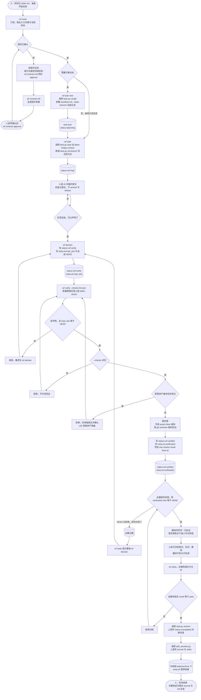
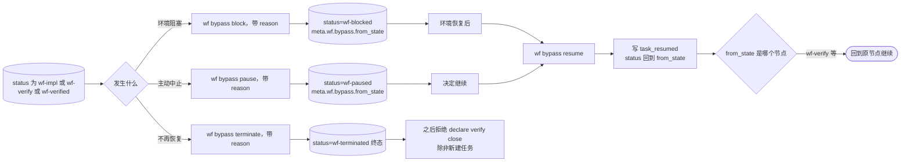
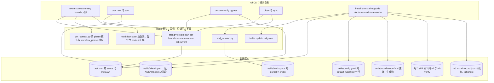
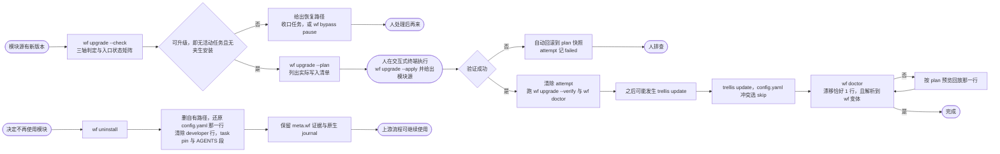

# 模块流程流转图（v4 · 单人单分支 · 原生优先）

> 本文件是 [1.2-零补丁嵌入方案.md](1.2-零补丁嵌入方案.md)（v4）的**图示版**，供人工审查流程是否正确。
> **图不引入新规则**：每处判定都标注了方案里的章节号；两者冲突时**以方案正文为准**。
> 本版新增**项目级契约**这一前置（`.wf/contract.yaml`，见方案 §4.2.1）——v20 §6.1 的"契约未定不应开任务"在图 1 顶部体现。

**图例**（四图通用）

| 形状 | 含义 |
|---|---|
| 圆角矩形 | **人**的动作或人工决策点 |
| 矩形 | `wf` 子命令（模块自己的 CLI） |
| 矩形内注明"调用 …" | 该步是 **Trellis 原生命令**，模块只是调用（图中不单设形状，避免与 `wf` 命令混淆） |
| 圆柱 | **状态或产物**（`task.json` 或文件系统） |
| 菱形 | **门禁**（fail-closed 判定） |

---

## 图 1：任务生命周期与证据有效期（主流程）

**审查要点（图 1）**

| # | 要审的点 | 方案出处 |
|---|---|---|
| 1 | 模块内终态是 **`wf-verified` + 证据有效**；"落到主干"完全在人手里，模块不判定 | §4.3.3、D20 |
| 2 | 证据过期**不自动重验**，只提示重新 `declare`（决定权留给人） | §4.3.3、P12 |
| 3 | 三个 fail-closed 前置：无声明 / 空检查 / 受管资产被改 | §4.5 |
| 4 | `close` 的门只看证据，**不看"有没有合并"** | §4.7 |
| 5 | 归档由上游完成（写 `completed` 并移目录），模块不改上游行为 | §4.3 注 |
| 6 | **契约未确认时不许开任务**（v20 §6.1/§11.1 的硬前置）；`approve` 必须人执行 | **§4.2.1** |

---

## 图 2：旁路与恢复（阻塞 / 暂停 / 终止）

**审查要点（图 2）**

| # | 要审的点 | 方案出处 |
|---|---|---|
| 1 | 旁路**不参与**完成判定，也不清零或增加连续失败信号 | §4.5、v20 §5.1.1 |
| 2 | `from_state` 必须记录，否则恢复无落点 | §4.5 |
| 3 | `terminate` 是终态，走**人类专用入口**（TTY 加令牌） | §4.7 |
| 4 | 环境阻塞恢复后**不强制重跑集成链路**（该链路已删除） | D20 |

---

## 图 3：命令到原生调用的映射与写入面（"不重复实现"的对照）

**审查要点（图 3）**

| # | 要审的点 | 方案出处 |
|---|---|---|
| 1 | 状态与证据都落在**原生 `task.json`**；没有第二套记录存储 | §0.4、V1 |
| 2 | 模块**不写** `commit`、`pr_url`、`worktree_path`；只在 `status` 扩展取值，在 `meta.wf.*` 写证据 | **§4.12** |
| 3 | 受管写入只有 `config.yaml` 一行；其余是块外追加或原生不扫描的新路径 | §4.1、§2.2 |
| 4 | 对上游只做调用：没有 hook 接管，也没有改 `workflow.md` | V5、§4.8 |

---

## 图 4：升级与拆卸（模块自身生命周期）

**审查要点（图 4）**

| # | 要审的点 | 方案出处 |
|---|---|---|
| 1 | 升级**不自动提交**；`--apply` 必须人在交互式终端执行 | §5.5、§5.3 |
| 2 | 回滚范围等于 `--plan` 的实际写入清单（不再维护第二份手写路径表） | §5.5 |
| 3 | `trellis update` 之后必须跟 `wf doctor`（顺序可恢复，不是无关） | §4.8、§5.4C |
| 4 | 拆卸**保留** `meta.wf.*` 与原生 journal（它们已属项目历史） | §5.7 |

---

## 与 v20 的对应关系（一眼核对有没有跑偏）

| v20 节点 | 本模块的落点 | 图上位置 |
|---|---|---|
| 项目级**定标** | **有机制**：`.wf/contract.yaml` + `wf contract init/show/approve`；**未确认不许开任务** | 图 1 的 C0–C3 |
| 项目级**设计 / 计划** | **照常做、由人确认**，产物落宿主文档；模块不设机制（无可自动判定的完成态），但**流程上必须执行** | 未画（方案 §4.2.1） |
| 任务级：定标 → 实施 → 验证 → 收口 | `task new` → `start` → `declare/verify` → `close` | 图 1 |
| 完成由可复现证据派生 | `status=wf-verified` 且 `meta.wf.verification.sha == HEAD` | 图 1 的 R 与 T |
| 状态由记录派生 | 状态就在 `task.json.status`（原生字段，全 CLI 可见） | 图 1 |
| 手动只维护旁路 | `wf bypass {block, pause, terminate, resume}` | 图 2 |
| 合入链路（v2） | **由人手动完成**；模块不提供其命令与门禁 | 图 1 的 W |
| 三级验证 | 保留语义、收敛为两档：`in-place` 与 `quasi-clean`（`clean` 属 v6 条件层，届时再加） | 图 1 的 P |
| 有交集与重验分支 | **不存在**（不切分支、不合并） | — |
| 信任根与锚点 | `wf self-hash`、`--from-anchor` 加 blob 哈希断言 | 未画（属验证内部实现） |
| 发布（G-C，v6） | 属条件层：**有真实部署目标时启用**；模块提供 `wf release`，但执行权在人（独立终端） | 未画（P5） |
