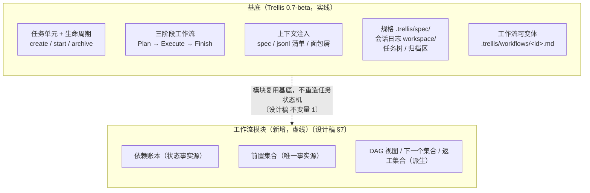
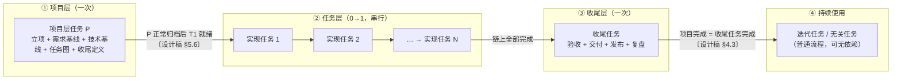
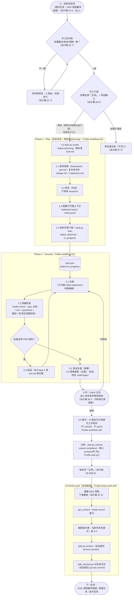
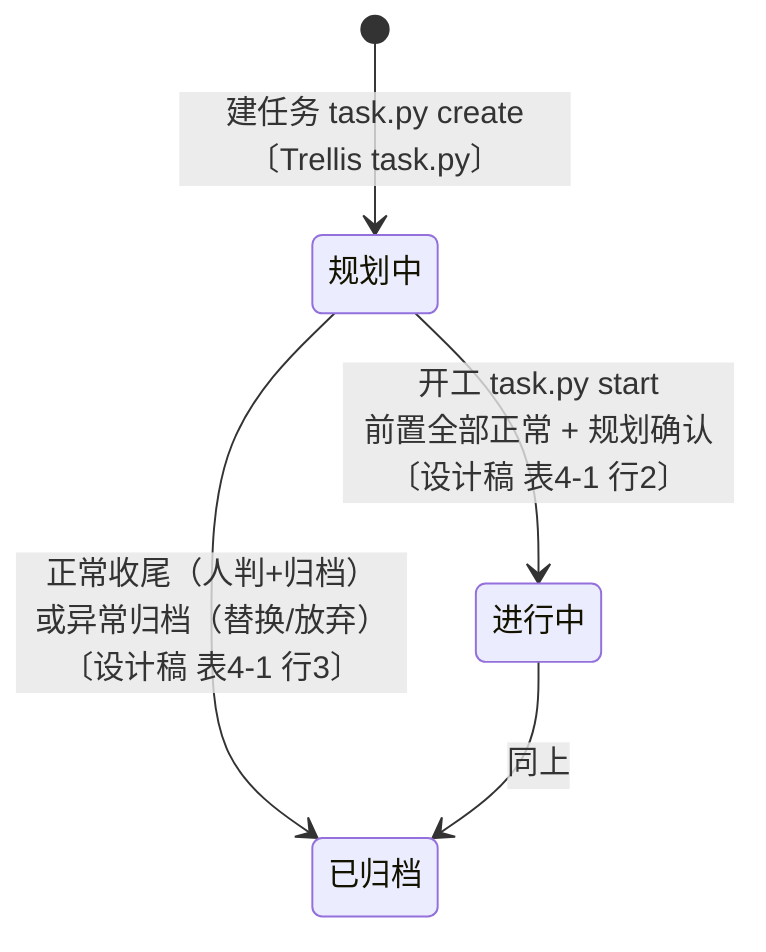
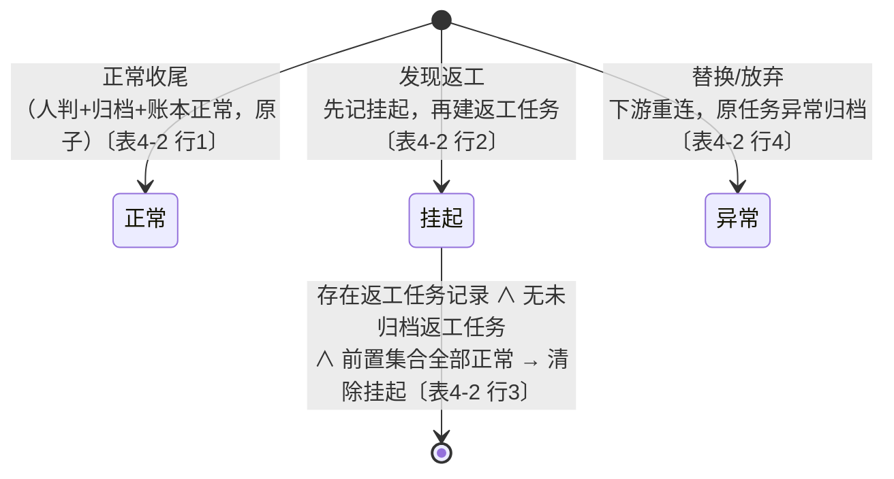
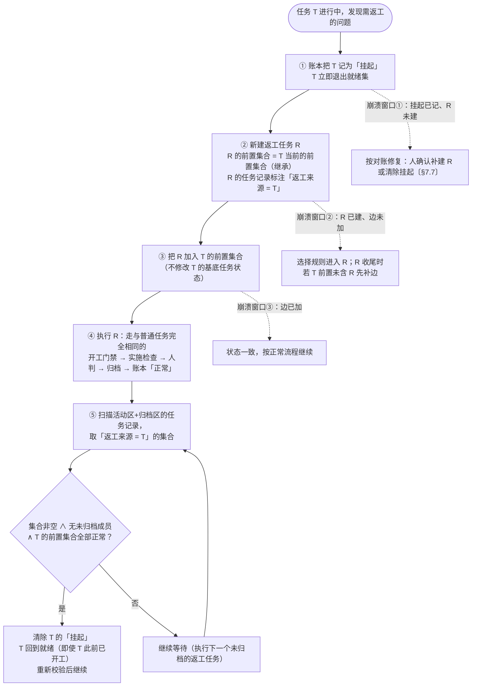
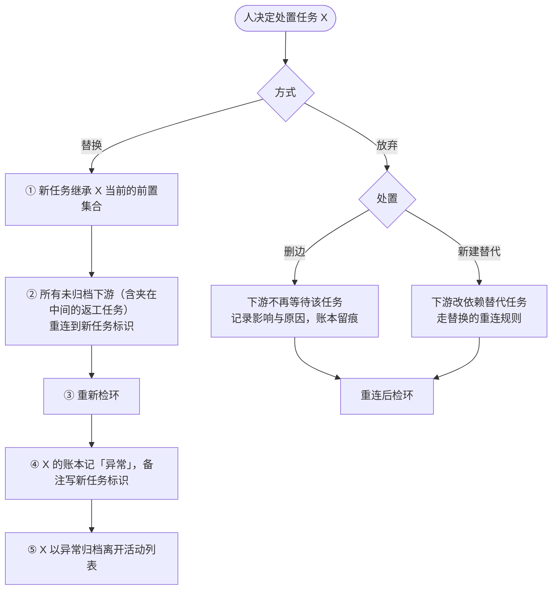
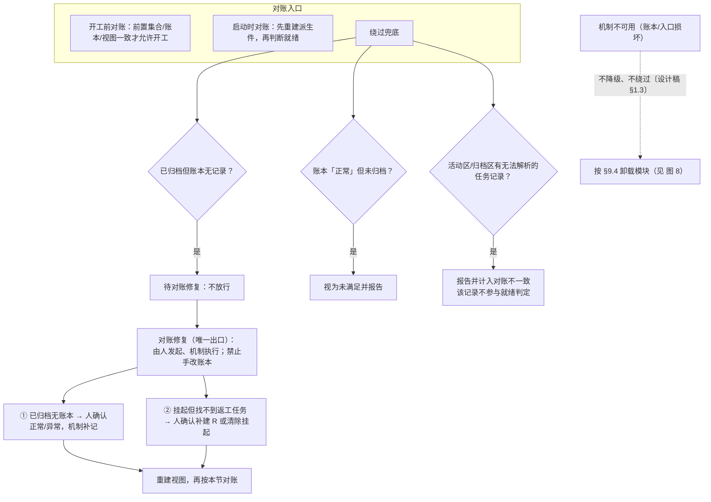
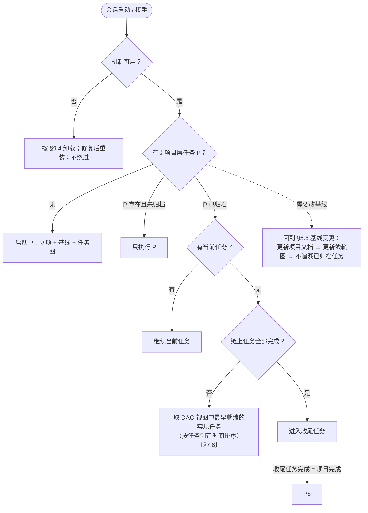
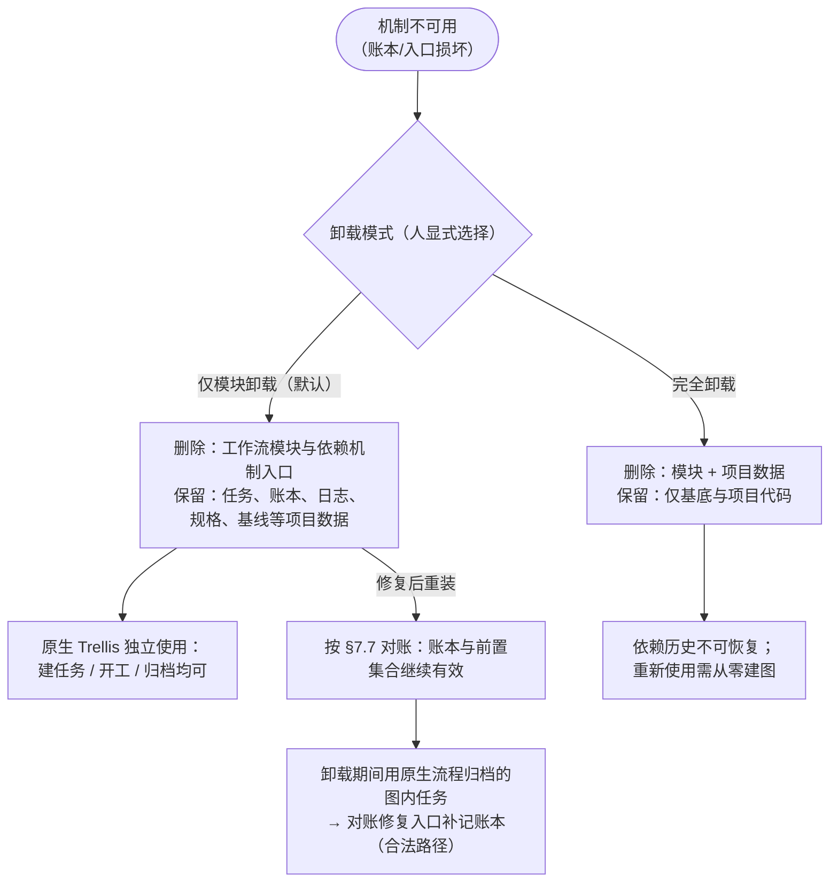

# 全流程流转图（设计稿 v24 × Trellis 0.7-beta 基底）

> 本文件是 [workflow-design.md](./workflow-design.md)（v24）配以 Trellis 官方源码（`feat/v0.7-beta` 分支，0.7.0-beta.4）机制事实的**全流程图示版**，供人通读与审查。
> **事实来源只有两份**：① 设计稿 `workflow-design.md` v24；② Trellis 源码 `~/projects/other/Trellis`（`feat/v0.7-beta`）。图中每处流转都标注来源（〔设计稿 §N〕或〔Trellis …〕）；两份来源未规定的一律不画。
> **图不引入新规则**：图与设计稿正文冲突时以正文为准；依赖机制的实现细节以配套文档《依赖机制设计说明》为准，本图只画设计稿 §7 内联的设计层约束。

**图例**（通用）

| 形状/样式 | 含义 |
|---|---|
| 圆角框 `([...])` | **人**的动作或人工判断点 |
| 矩形 | 机制/命令动作（基底或依赖机制） |
| 圆柱 `[( )]` | 状态或产物（`task.json`、账本、文件系统） |
| 菱形 | 门禁判定（fail 时不放行） |
| 虚线边框 | 该层属于**工作流模块**（依赖机制）新增；实线为**基底**（Trellis 原生） |
| 〔设计稿 §N〕 | 设计稿章节溯源 |
| 〔Trellis workflow.md〕〔Trellis task.py〕〔Trellis finish-work.md〕 | 基底源码溯源 |

---

## 图 0：两层分工总览

〔设计稿 §1.2〕基底（Trellis 机制层）负责"任务怎么走"；工作流模块只新增**依赖机制**，负责"项目怎么开始与结束、任务按什么顺序走"。



基底关键机制（源码事实）：

- 任务生命周期命令：`task.py create`（写 `status=planning`，并自动设会话活动任务指针）、`start`（`planning`→`in_progress`）、`finish`（仅清除活动指针，不改状态）、`archive`（写 `status=completed` + `completedAt`，目录移入 `archive/{年-月}/`，删除指向它的会话指针，自动提交）。〔Trellis workflow.md / task.py `cmd_archive`〕
- 任务状态由生命周期命令写入的取值只有三个：`planning` / `in_progress` / `completed`。〔Trellis task.py〕（`list --status` 的帮助文字里还提到 `review` 过滤值，但没有任何生命周期命令会写入它，本图不使用。）
- 工作流三阶段：Phase 1 Plan（1.0 建任务 → 1.1 需求探索 → 1.2 研究 → 1.3 配置子代理上下文 → 1.4 激活）→ Phase 2 Execute（2.1 实施 → 2.2 质量检查 → 2.3 回退）→ Phase 3 Finish（3.2 调试复盘 → 3.3 规格更新 → 3.4 提交 → 3.5 收尾）。〔Trellis workflow.md〕
- 工作流变体：任务可用 `task.json.workflow` 钉住一个变体文件（`.trellis/workflows/<id>.md`）；解析优先级 per-task > personal(`.developer`) > `default_workflow` > 全局 `workflow.md`。〔Trellis config.yaml〕
- 生命周期 hooks：`after_create / after_start / after_finish / after_archive`。〔Trellis workflow.md / config.yaml〕

---

## 图 1：项目全生命周期（四段结构）

〔设计稿 §4.1〕一个项目从头到尾的四段：



各段出口（〔设计稿 §4.1 表〕）：

| 段 | 承载 | 出口 |
|---|---|---|
| 项目层 | 项目层任务 P | 人确认 + P 正常归档 |
| 任务层 | 实现任务 | 人判 + 正常归档 |
| 收尾层 | 收尾任务 | 人验收 + 归档 |
| 持续使用 | 普通任务 | 原生流程 |

> 返工不改四段结构：返工任务插在当前任务之前，是图内正常任务；"返工"动作通过依赖级挂起实现。〔设计稿 §4.1〕

---

## 图 2：单个任务完整生命周期（基底阶段 × 依赖机制）

这是全流程的核心图。左侧是基底三阶段（Trellis 源码事实），右侧标注依赖机制在各关卡插入的动作（设计稿）。**图内任务**（P、实现任务、返工任务、收尾任务）走完整路径；**图外任务**（无关任务、迭代任务）只走基底原生路径，不走依赖机制入口。〔设计稿 不变量 5、§9.2〕



**原子收尾**（〔设计稿 §5.3 / §6.3〕）：`人判 → 归档 → 账本写"正常" → 重建 DAG 视图` 四步是一个整体——任一步失败，下游都不能看到"已正常"；失败按对账恢复（图 6），不重放。

**完成的定义**（〔设计稿 §4.3〕）：

```text
任务完成 = 基底完成实施与检查 ∧ 人判 ∧ 已归档
项目完成 = 收尾任务完成
依赖满足 = 前置任务在账本中状态为「正常」
```

- 检查 = 基底 Phase 2.2 的 check（对应 Trellis 的 `trellis-check` 环节）；不要求 sha 级证据链；
- 人判 = check 之后由人决定是否继续收尾，是基底原生流程的一部分，痕迹在会话日志/任务记录中；
- 归档 = 基底 `task.py archive`；归档是完成的必要条件，也是账本写"正常"的前置；
- 推送不参与完成判定；推送由人执行。〔设计稿 §1.1〕

**会话收尾的提交顺序**（源码事实，〔Trellis finish-work.md〕）：`工作提交（Phase 3.4）→ chore(task): archive … → chore: record journal`。

---

## 图 3：双轨状态流转

〔设计稿 §4.2 / §4.4〕任务状态与依赖状态**分层不互写**：任务状态只由基底的建任务/开工/归档动作写；依赖状态只由机制的收尾/返工/替换/放弃/对账修复动作写。

### 3a 任务状态（基底承载，只有三态）



任务内部的阶段回退（Phase 2.3 回 Phase 1）**不改变**任务状态。〔设计稿 §4.2〕

### 3b 依赖状态（账本承载，四态）



对下游的结论（〔设计稿 §7.4〕）：`无记录`→不满足；`挂起`→不满足；`正常`→满足；`异常`→不满足，需重连。

- "正常"只由收尾逻辑或对账修复写入；
- "异常/挂起"不可由派生件重建，必须随版本库保存；账本不自动清理；
- **异常没有例外通道**：下游要继续，只能替换/放弃重连，或删边后不再等待。〔设计稿 §4.4、§7.4〕

---

## 图 4：返工子流程

〔设计稿 §6.4〕当前任务 T 在执行中发现问题需要返工时：



要点（源出设计稿 §6.4）：

- 返工任务是**图内正常任务**，遵守同一套开工/收尾；"返工"通过依赖级挂起实现，不是另一套任务生命周期；
- 挂起按"返工任务集合"整体清除，不按单个 R 的归档时点清除；已归档的返工任务（正常、被替换或放弃）不再阻塞；
- 集合只从任务记录派生（活动区+归档区），不存 ID 列表；无法解析的记录计入对账不一致，不静默当作"没有返工任务"；
- "返工来源"必须在归档前写入（归档区是只读历史）。

---

## 图 5：替换与放弃

〔设计稿 §6.5 / §6.6〕任务无法继续或不再需要时的两条处置路径，均属**任务级旁路**（改任务生命周期）：



特殊情形（源出设计稿 §6.5 / §6.6）：

- 被替换/放弃的 T 处于**挂起**时：其前置 R 不属于"未归档下游"，**不重连**；R 留在图中按普通任务处置；新任务继承 T 的当前前置集合（含 R），仍等待 R；若人决定不再需要 R，按放弃处置 R。
- 替换返工任务 R 时：新任务继承 R 的"返工来源"标记；R 异常归档后不再阻塞 T 的挂起。
- 替换任务自身从"无记录"开始，正常收尾后才记"正常"。

---

## 图 6：对账与恢复

〔设计稿 §7.7〕三类对账入口 + 唯一修复出口：



- 不保留操作日志：原子收尾失败时按上述规则恢复到确定状态，**不重放**；
- 仅模块卸载期间用原生流程归档的图内任务，重装后走"对账修复"入口补记账本——这是**设计允许的合法路径**，不是异常。〔设计稿 §9.4〕

---

## 图 7：入口路由（接手任何会话的第一步）

〔设计稿 §9.1〕任何新会话/新 CLI 接手时的路由表，配合接手四步（〔设计稿 §8.4〕）：



**接手四步**（〔设计稿 §8.4〕）：① 读 DAG 视图确认就绪任务 → ② 读账本确认前置状态与挂起项 → ③ 读任务记录与基线确认要做什么 → ④ 异常按图 4 崩溃规则 / 图 6 对账修复处理，不直接放行。AI 的意图叙述只作补充，不作位置判定依据。

---

## 图 8：机制不可用与卸载

〔设计稿 §9.4〕机制不可用时**没有绕过的降级路径**，唯一恢复动作是卸载：



- 卸载由人发起并选择模式；AI 可协助执行，但必须显式说明模式与影响，不得代替人决定完全卸载；
- 两种模式都必须满足：卸载后原生 Trellis 可独立建任务、开工、归档，不留下阻断原生流程的状态或文件。

---

## 附录 A：设计稿术语 ↔ Trellis 0.7-beta 实现对照

| 设计稿概念〔§3 术语〕 | Trellis 源码对应（事实） | 备注 |
|---|---|---|
| 任务状态：规划中 | `task.json.status = "planning"`，由 `task.py create` 写入 | 〔Trellis task.py〕 |
| 任务状态：进行中 | `task.json.status = "in_progress"`，由 `task.py start` 写入 | 〔Trellis task.py〕 |
| 任务状态：已归档 | `task.py archive`：写 `status="completed"` + `completedAt`，目录移入 `archive/{年-月}/` | 归档动作同时完成"状态+位置"〔Trellis task_store `cmd_archive`〕 |
| 规划确认（开工门禁的一半） | Phase 1.4：产物评审后才 `task.py start`（轻量可仅 prd.md；复杂任务需 prd/design/implement 齐备） | 〔Trellis workflow.md〕 |
| 基底 check | Phase 2.2 `trellis-check`：spec 合规 + lint + typecheck；最后一轮须全范围 | 〔Trellis workflow.md〕 |
| 人判 | check 之后由人决定是否继续收尾；原生环节，不新增命令或记录 | 〔设计稿 §4.3〕 |
| 会话日志 | `.trellis/workspace/<开发者>/journal-N.md`（单文件上限 2000 行，超出自动轮转） | 〔Trellis workflow.md / config.yaml〕 |
| 规格 | `.trellis/spec/`，按包/层组织，通过 hook/skill 注入而非靠记忆 | 〔Trellis workflow.md〕 |
| 规格回流 | Phase 3.3 `trellis-update-spec` | 〔Trellis workflow.md〕 |
| 提交由基底流程驱动 | Phase 3.4 批次提交计划 + 一次性确认；不 amend、不 push | 〔Trellis workflow.md〕 |
| 工作流可变体 | `.trellis/workflows/<id>.md`；优先级 per-task > personal > default > global | 〔Trellis config.yaml〕 |
| 依赖状态、账本、前置集合、DAG 视图 | **Trellis 基底不提供**——这是工作流模块唯一新增的机制 | 〔设计稿 §0 前提 3、§7〕 |
| 任务树（父子） | `task.py add-subtask / remove-subtask`；明确声明"父子结构不是依赖系统" | 基底提供；设计稿的顺序保障不用它，用依赖边〔Trellis workflow.md〕 |

---

## 附录 B：本文档的事实边界

- **画入的内容**：设计稿 §1–§10 及附录的规范内容；Trellis `feat/v0.7-beta`（0.7.0-beta.4）中 `packages/cli/src/templates/trellis/`（workflow.md、config.yaml、scripts/task.py、scripts/common/task_store.py）与 `packages/cli/src/templates/common/commands/finish-work.md` 的可核实机制。
- **未画入的内容**：依赖机制的实现级细节（状态表全文、扫描实现、性能手段）——设计稿 §7.9 规定以配套文档《依赖机制设计说明》为准，该文档不在本次事实范围内；模块安装/升级/卸载的命令与文件布局——设计稿 §1.2 规定由实现方案承载。
- **已知证据限制**：Trellis `task.py list` 帮助文本提到 `review` 状态过滤值，但无生命周期命令写入该值；本图按实际写入者只取三态。设计稿措辞"已归档"对应实现中 `archive` 的"completed + 移目录"组合动作，本图按此映射并在附录 A 标注。
